Assignment 5: ggplot2
================
TUYISHIME Emmanuel
2026-11-10

``` r
# Load required package
library(ggplot2)

# Load datasets
data("iris")
data("economics", package = "ggplot2")

# Define the image folder
image_dir <- "C:/Users/user/Pictures/assignment 5 images"

# Create the folder if it does not exist
if (!dir.exists(image_dir)) {
  dir.create(image_dir, recursive = TRUE)
}
```

# Applying ggplot2 Visualization Functions

## 1. geom_bar() – Bar Chart

Counts the number of flowers belonging to each species.

``` r
p1 <- ggplot(iris, aes(x = Species)) +
  geom_bar(fill = "steelblue") +
  labs(
    title = "Number of Flowers by Species",
    x = "Species",
    y = "Frequency"
  ) +
  theme_minimal()

print(p1)
```

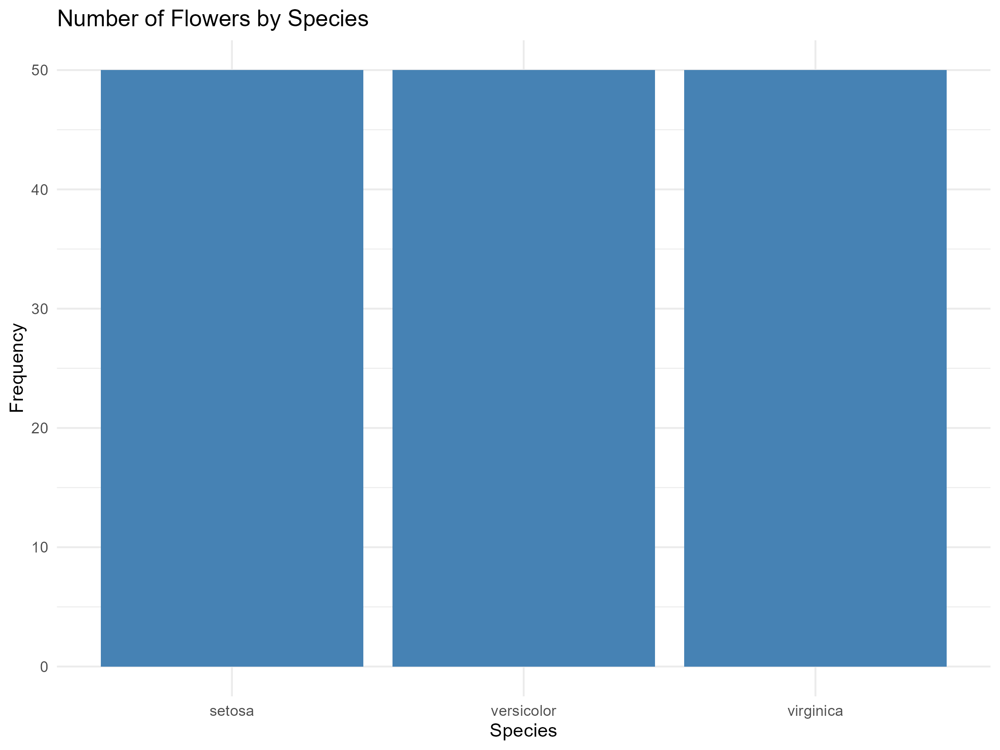<!-- -->

``` r
ggsave(
  filename = file.path(image_dir, "species_bar_chart.png"),
  plot = p1,
  width = 8,
  height = 6,
  dpi = 300
)
```

## 2. geom_boxplot() – Boxplot

Displays the median, first quartile, third quartile, spread and
potential outliers.

``` r
p2 <- ggplot(iris, aes(x = Species, y = Sepal.Length)) +
  geom_boxplot(fill = "lightblue") +
  labs(
    title = "Sepal Length by Species",
    x = "Species",
    y = "Sepal Length"
  ) +
  theme_minimal()

print(p2)
```

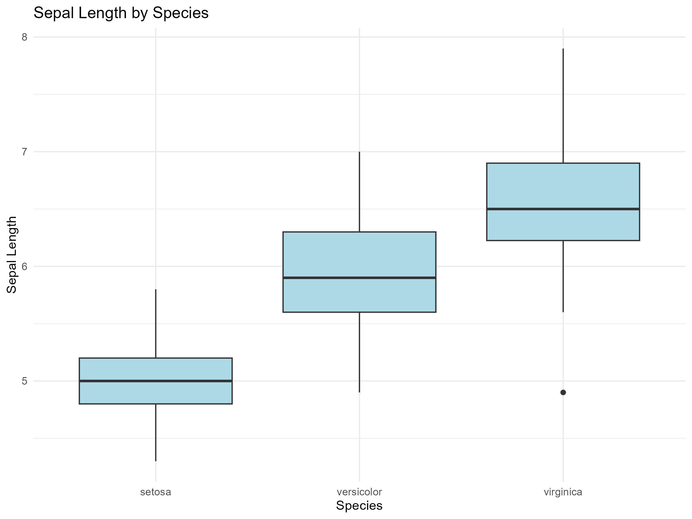<!-- -->

``` r
ggsave(
  filename = file.path(image_dir, "sepal_length_boxplot.png"),
  plot = p2,
  width = 8,
  height = 6,
  dpi = 300
)
```

## 3. geom_density() – Density Plot

Shows the estimated distribution of a continuous variable.

``` r
p3 <- ggplot(iris, aes(x = Sepal.Length)) +
  geom_density(fill = "lightgreen", alpha = 0.6) +
  labs(
    title = "Density Distribution of Sepal Length",
    x = "Sepal Length",
    y = "Density"
  ) +
  theme_minimal()

print(p3)
```

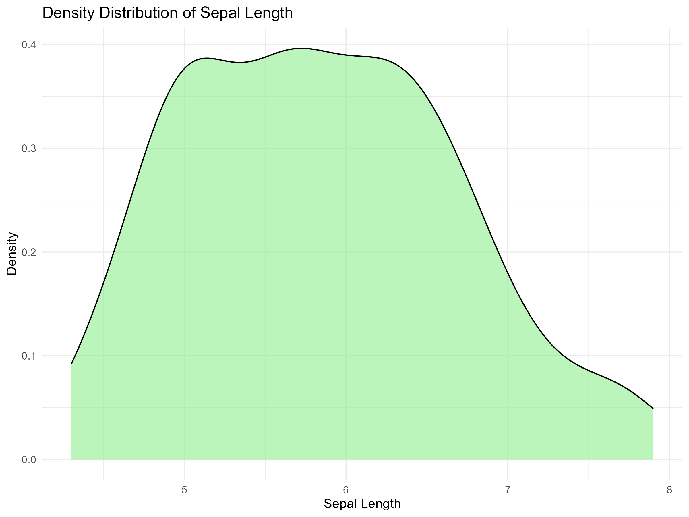<!-- -->

``` r
ggsave(
  filename = file.path(image_dir, "sepal_length_density.png"),
  plot = p3,
  width = 8,
  height = 6,
  dpi = 300
)
```

## 4. geom_histogram() – Histogram

Groups numerical observations into intervals and displays their
frequencies.

``` r
p4 <- ggplot(iris, aes(x = Sepal.Length)) +
  geom_histogram(
    bins = 15,
    fill = "orange",
    color = "black"
  ) +
  labs(
    title = "Histogram of Sepal Length",
    x = "Sepal Length",
    y = "Frequency"
  ) +
  theme_minimal()

print(p4)
```

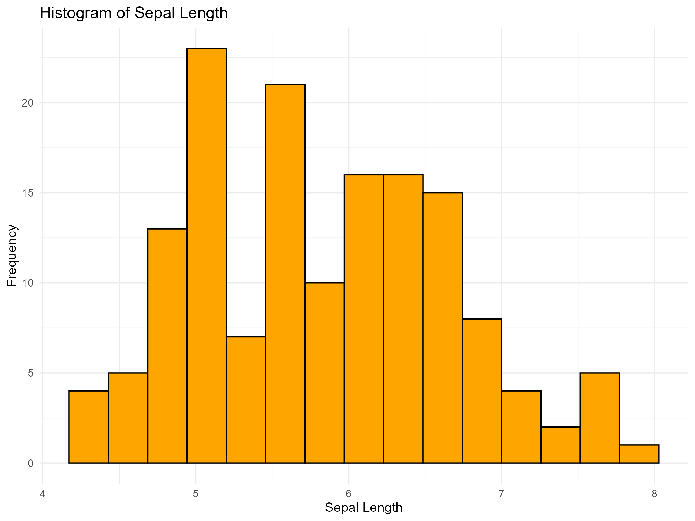<!-- -->

``` r
ggsave(
  filename = file.path(image_dir, "sepal_length_histogram.png"),
  plot = p4,
  width = 8,
  height = 6,
  dpi = 300
)
```

## 5. geom_hline() – Horizontal Line

Adds a horizontal reference line. Here, the line is at frequency 20.

``` r
p5 <- ggplot(iris, aes(x = Sepal.Length)) +
  geom_histogram(bins = 15, fill = "skyblue") +
  geom_hline(
    yintercept = 20,
    color = "red",
    linewidth = 1
  ) +
  labs(
    title = "Histogram with Horizontal Reference Line",
    x = "Sepal Length",
    y = "Frequency"
  ) +
  theme_minimal()

print(p5)
```

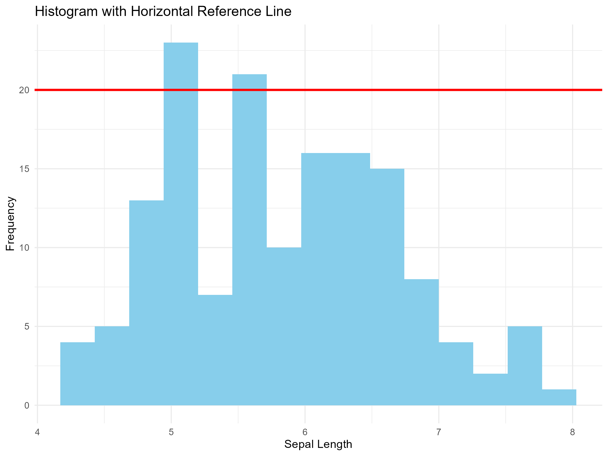<!-- -->

``` r
ggsave(
  filename = file.path(image_dir, "horizontal_line.png"),
  plot = p5,
  width = 8,
  height = 6,
  dpi = 300
)
```

## 6. geom_jitter() – Jitter Plot

Adds small random horizontal movements to points to prevent overlapping.

``` r
p6 <- ggplot(iris, aes(x = Species, y = Sepal.Length)) +
  geom_jitter(
    color = "blue",
    width = 0.2,
    height = 0
  ) +
  labs(
    title = "Sepal Length by Species",
    x = "Species",
    y = "Sepal Length"
  ) +
  theme_minimal()

print(p6)
```

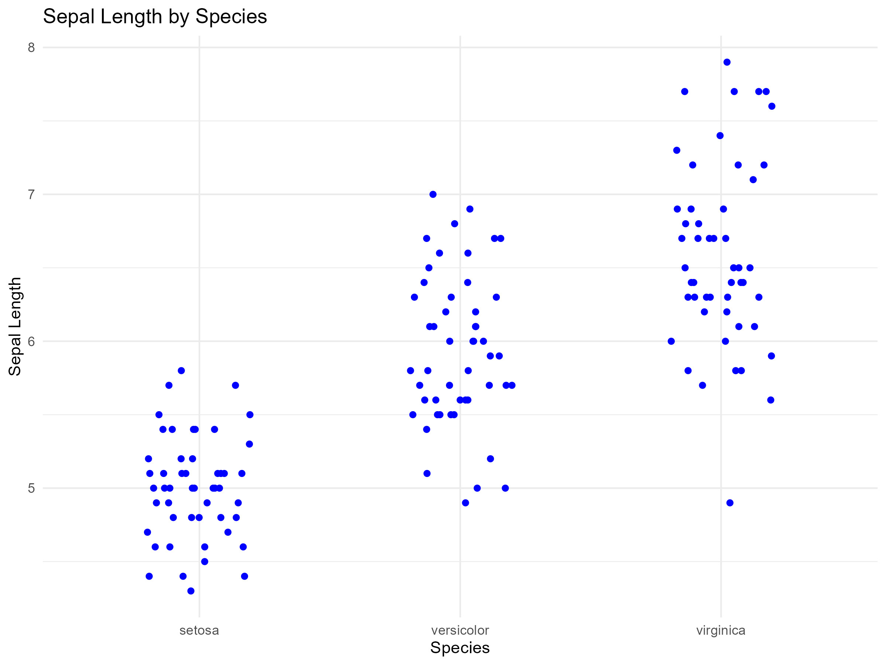<!-- -->

``` r
ggsave(
  filename = file.path(image_dir, "jitter_plot.png"),
  plot = p6,
  width = 8,
  height = 6,
  dpi = 300
)
```

## 7. geom_line() – Line Graph

Connects observations to show changes or trends over time.

``` r
p7 <- ggplot(economics, aes(x = date, y = unemploy)) +
  geom_line(color = "blue") +
  labs(
    title = "Unemployment Over Time",
    x = "Date",
    y = "Number Unemployed"
  ) +
  theme_minimal()

print(p7)
```

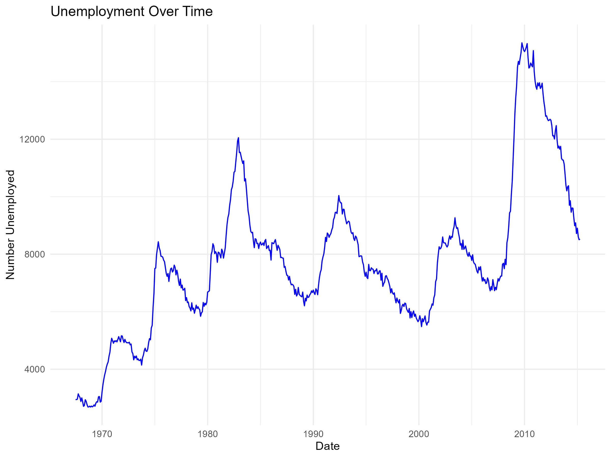<!-- -->

``` r
ggsave(
  filename = file.path(image_dir, "unemployment_line_graph.png"),
  plot = p7,
  width = 8,
  height = 6,
  dpi = 300
)
```

## 8. geom_rug() – Rug Plot

Displays small marks along the axis representing individual
observations.

``` r
p8 <- ggplot(iris, aes(x = Sepal.Length)) +
  geom_density(fill = "lightblue", alpha = 0.5) +
  geom_rug(color = "red") +
  labs(
    title = "Density Plot with Rug",
    x = "Sepal Length",
    y = "Density"
  ) +
  theme_minimal()

print(p8)
```

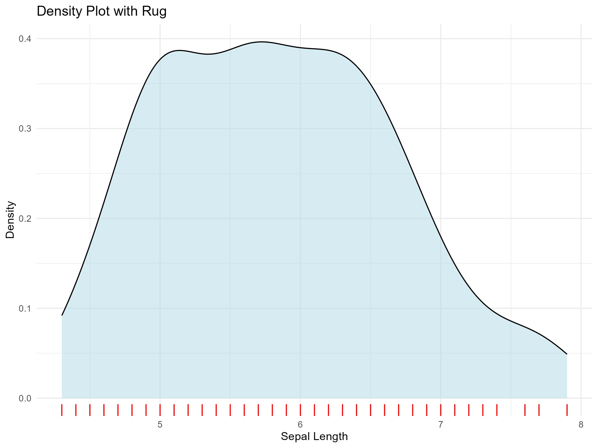<!-- -->

``` r
ggsave(
  filename = file.path(image_dir, "density_rug_plot.png"),
  plot = p8,
  width = 8,
  height = 6,
  dpi = 300
)
```

## 9. geom_text() – Adding Text

Adds numerical or descriptive labels to a graph.

``` r
species_mean <- aggregate(
  Sepal.Length ~ Species,
  data = iris,
  FUN = mean
)

p9 <- ggplot(
  species_mean,
  aes(x = Species, y = Sepal.Length)
) +
  geom_col(fill = "steelblue") +
  geom_text(
    aes(label = round(Sepal.Length, 2)),
    vjust = -0.5
  ) +
  labs(
    title = "Mean Sepal Length by Species",
    x = "Species",
    y = "Mean Sepal Length"
  ) +
  theme_minimal()

print(p9)
```

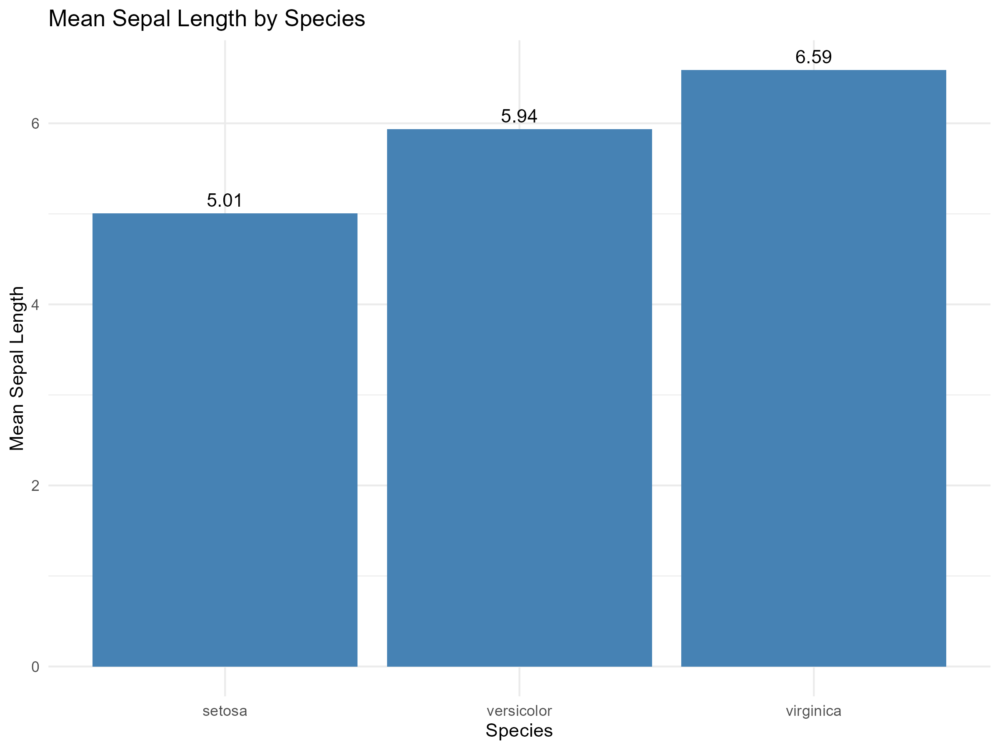<!-- -->

``` r
ggsave(
  filename = file.path(image_dir, "mean_sepal_length_labels.png"),
  plot = p9,
  width = 8,
  height = 6,
  dpi = 300
)
```

## 10. geom_violin() – Violin Plot

Shows the distribution and density of observations for each category.

``` r
p10 <- ggplot(iris, aes(x = Species, y = Sepal.Length)) +
  geom_violin(fill = "purple", alpha = 0.6) +
  labs(
    title = "Violin Plot of Sepal Length",
    x = "Species",
    y = "Sepal Length"
  ) +
  theme_minimal()

print(p10)
```

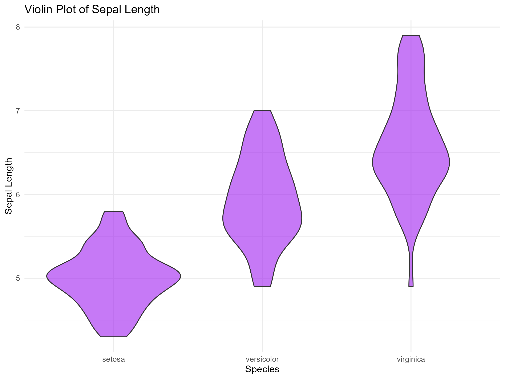<!-- -->

``` r
ggsave(
  filename = file.path(image_dir, "sepal_length_violin.png"),
  plot = p10,
  width = 8,
  height = 6,
  dpi = 300
)
```

## 11. geom_vline() – Vertical Line

Adds a vertical reference line at the mean sepal length.

``` r
mean_length <- mean(iris$Sepal.Length)

p11 <- ggplot(iris, aes(x = Sepal.Length)) +
  geom_histogram(
    bins = 15,
    fill = "lightblue"
  ) +
  geom_vline(
    xintercept = mean_length,
    color = "red",
    linewidth = 1
  ) +
  labs(
    title = "Histogram with Mean Vertical Line",
    x = "Sepal Length",
    y = "Frequency"
  ) +
  theme_minimal()

print(p11)
```

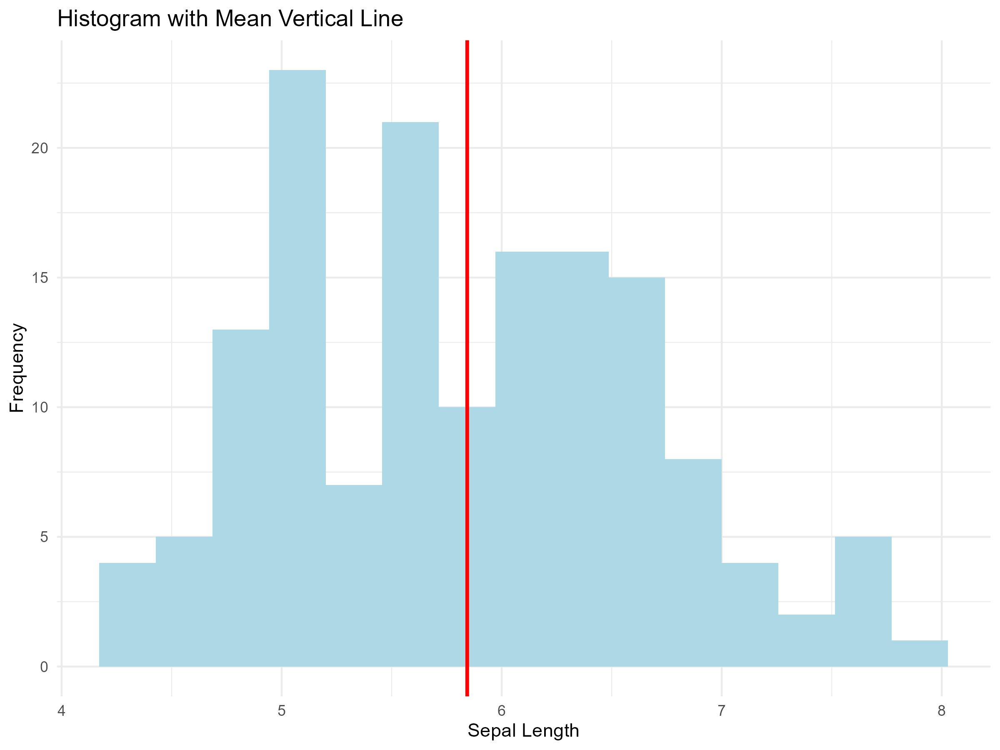<!-- -->

``` r
ggsave(
  filename = file.path(image_dir, "vertical_line.png"),
  plot = p11,
  width = 8,
  height = 6,
  dpi = 300
)
```

# Conclusion

This assignment demonstrates eleven ggplot2 visualization functions
using the built-in R datasets `iris` and `economics`. These
visualizations help present categorical data, numerical distributions,
relationships and trends in a clear graphical format.
