R Programming Course Project
================
TUYISHIME Emmanuel
2026-10-31

- [Introduction](#introduction)
- [Assignment 1: Importing Data from Different
  Sources](#assignment-1-importing-data-from-different-sources)
  - [1.1 Importing data from a CSV
    file](#11-importing-data-from-a-csv-file)
    - [Display the first five
      observations](#display-the-first-five-observations)
    - [Examine the dataset structure](#examine-the-dataset-structure)
    - [Summary statistics](#summary-statistics)
    - [Number of rows and columns](#number-of-rows-and-columns)
    - [Variable names](#variable-names)
    - [Check missing values](#check-missing-values)
    - [Export the imported dataset](#export-the-imported-dataset)
    - [Create and export a summary
      table](#create-and-export-a-summary-table)
- [Import students table](#import-students-table)
- [Display records](#display-records)
  - [Exploring the students dataset](#exploring-the-students-dataset)
  - [Exporting the dataset](#exporting-the-dataset)
  - [Disconnecting from MySQL](#disconnecting-from-mysql)
  - [1.4 Importing data from an online
    API](#14-importing-data-from-an-online-api)
    - [Exploring the API Dataset](#exploring-the-api-dataset)
- [Assignment 2: Basic R Programming and Data
  Analysis](#assignment-2-basic-r-programming-and-data-analysis)
  - [2.1 Creating vectors and calculating summary
    statistics](#21-creating-vectors-and-calculating-summary-statistics)
  - [2.2 Logical vectors](#22-logical-vectors)
  - [2.3 Character vectors](#23-character-vectors)
  - [2.4 Integer vectors](#24-integer-vectors)
  - [2.5 Complex numbers](#25-complex-numbers)
  - [2.6 Creating and multiplying
    matrices](#26-creating-and-multiplying-matrices)
  - [2.7 Creating a list](#27-creating-a-list)
  - [2.8 Creating a factor](#28-creating-a-factor)
  - [2.9 Identifying and handling missing
    values](#29-identifying-and-handling-missing-values)
  - [2.10 Creating a data frame](#210-creating-a-data-frame)
  - [2.11 Creating a data frame for height and
    weight](#211-creating-a-data-frame-for-height-and-weight)
    - [Print, summarize, and inspect the data
      frame](#print-summarize-and-inspect-the-data-frame)
    - [Export the data frame](#export-the-data-frame)
  - [2.12 Applying functions to rows and
    columns](#212-applying-functions-to-rows-and-columns)
  - [2.13 Importing built-in data in
    R](#213-importing-built-in-data-in-r)
  - [2.14 Visualizing the iris dataset using a
    boxplot](#214-visualizing-the-iris-dataset-using-a-boxplot)
  - [2.15 Relationship between two categorical
    variables](#215-relationship-between-two-categorical-variables)
    - [Exploring one department](#exploring-one-department)
  - [2.16 Creating bar plots](#216-creating-bar-plots)
  - [2.17 Scatter plots and
    correlation](#217-scatter-plots-and-correlation)
  - [2.18 Linear regression model](#218-linear-regression-model)
  - [2.19 Histograms](#219-histograms)
  - [2.20 Adding a smooth line to a
    plot](#220-adding-a-smooth-line-to-a-plot)
  - [2.21 Creating a body mass index (BMI)
    variable](#221-creating-a-body-mass-index-bmi-variable)
  - [2.22 Working with dates](#222-working-with-dates)
  - [2.23 Creating a leadership
    dataset](#223-creating-a-leadership-dataset)
  - [2.24 Handling missing values and creating age
    categories](#224-handling-missing-values-and-creating-age-categories)
  - [2.25 Sorting and subsetting data](#225-sorting-and-subsetting-data)
- [Conclusion](#conclusion)

# Introduction

This report demonstrates how to import data from different sources,
inspect and summarize datasets, perform basic R programming operations,
and carry out data management and visualization.

**Note:** This report displays the R code and the results produced when
the document is knitted. Package installation is done once in the
RStudio Console, not every time the report is knitted.

# Assignment 1: Importing Data from Different Sources

## 1.1 Importing data from a CSV file

The `readr` package is used to import the penguins dataset from a CSV
file.

``` r
library(readr)
library(tidyverse)

penguins <- read_csv(
  "C:/Users/user/Downloads/penguins.csv",
  show_col_types = FALSE
)
```

### Display the first five observations

``` r
head(penguins, 5)
```

    ## # A tibble: 5 × 8
    ##   species island    bill_len bill_dep
    ##   <chr>   <chr>        <dbl>    <dbl>
    ## 1 Adelie  Torgersen     39.1     18.7
    ## 2 Adelie  Torgersen     39.5     17.4
    ## 3 Adelie  Torgersen     40.3     18  
    ## 4 Adelie  Torgersen     NA       NA  
    ## 5 Adelie  Torgersen     36.7     19.3
    ## # ℹ 4 more variables: flipper_len <dbl>,
    ## #   body_mass <dbl>, sex <chr>, year <dbl>

### Examine the dataset structure

``` r
str(penguins)
```

    ## spc_tbl_ [344 × 8] (S3: spec_tbl_df/tbl_df/tbl/data.frame)
    ##  $ species    : chr [1:344] "Adelie" "Adelie" "Adelie" "Adelie" ...
    ##  $ island     : chr [1:344] "Torgersen" "Torgersen" "Torgersen" "Torgersen" ...
    ##  $ bill_len   : num [1:344] 39.1 39.5 40.3 NA 36.7 39.3 38.9 39.2 34.1 42 ...
    ##  $ bill_dep   : num [1:344] 18.7 17.4 18 NA 19.3 20.6 17.8 19.6 18.1 20.2 ...
    ##  $ flipper_len: num [1:344] 181 186 195 NA 193 190 181 195 193 190 ...
    ##  $ body_mass  : num [1:344] 3750 3800 3250 NA 3450 ...
    ##  $ sex        : chr [1:344] "male" "female" "female" NA ...
    ##  $ year       : num [1:344] 2007 2007 2007 2007 2007 ...
    ##  - attr(*, "spec")=
    ##   .. cols(
    ##   ..   species = col_character(),
    ##   ..   island = col_character(),
    ##   ..   bill_len = col_double(),
    ##   ..   bill_dep = col_double(),
    ##   ..   flipper_len = col_double(),
    ##   ..   body_mass = col_double(),
    ##   ..   sex = col_character(),
    ##   ..   year = col_double()
    ##   .. )
    ##  - attr(*, "problems")=<externalptr>

### Summary statistics

``` r
summary(penguins)
```

    ##    species             island         
    ##  Length:344         Length:344        
    ##  Class :character   Class :character  
    ##  Mode  :character   Mode  :character  
    ##                                       
    ##                                       
    ##                                       
    ##                                       
    ##     bill_len        bill_dep    
    ##  Min.   :32.10   Min.   :13.10  
    ##  1st Qu.:39.23   1st Qu.:15.60  
    ##  Median :44.45   Median :17.30  
    ##  Mean   :43.92   Mean   :17.15  
    ##  3rd Qu.:48.50   3rd Qu.:18.70  
    ##  Max.   :59.60   Max.   :21.50  
    ##  NA's   :2       NA's   :2      
    ##   flipper_len      body_mass   
    ##  Min.   :172.0   Min.   :2700  
    ##  1st Qu.:190.0   1st Qu.:3550  
    ##  Median :197.0   Median :4050  
    ##  Mean   :200.9   Mean   :4202  
    ##  3rd Qu.:213.0   3rd Qu.:4750  
    ##  Max.   :231.0   Max.   :6300  
    ##  NA's   :2       NA's   :2     
    ##      sex                 year     
    ##  Length:344         Min.   :2007  
    ##  Class :character   1st Qu.:2007  
    ##  Mode  :character   Median :2008  
    ##                     Mean   :2008  
    ##                     3rd Qu.:2009  
    ##                     Max.   :2009  
    ## 

### Number of rows and columns

``` r
dim(penguins)
```

    ## [1] 344   8

### Variable names

``` r
names(penguins)
```

    ## [1] "species"     "island"     
    ## [3] "bill_len"    "bill_dep"   
    ## [5] "flipper_len" "body_mass"  
    ## [7] "sex"         "year"

### Check missing values

``` r
colSums(is.na(penguins))
```

    ##     species      island    bill_len 
    ##           0           0           2 
    ##    bill_dep flipper_len   body_mass 
    ##           2           2           2 
    ##         sex        year 
    ##          11           0

### Export the imported dataset

``` r
write.csv(
  penguins,
  "penguins_clean.csv",
  row.names = FALSE
)
```

### Create and export a summary table

``` r
penguins_summary <- data.frame(
  Variable = names(penguins),
  Summary = sapply(penguins, function(x) {
    paste(capture.output(summary(x)), collapse = "; ")
  })
)

head(penguins_summary)
```

    ##                Variable
    ## species         species
    ## island           island
    ## bill_len       bill_len
    ## bill_dep       bill_dep
    ## flipper_len flipper_len
    ## body_mass     body_mass
    ##                                                                                                                            Summary
    ## species                                                                Length     Class      Mode ;       344 character character 
    ## island                                                                 Length     Class      Mode ;       344 character character 
    ## bill_len       Min. 1st Qu.  Median    Mean 3rd Qu. ;   32.10   39.23   44.45   43.92   48.50 ;    Max.    NA's ;   59.60       2 
    ## bill_dep       Min. 1st Qu.  Median    Mean 3rd Qu. ;   13.10   15.60   17.30   17.15   18.70 ;    Max.    NA's ;   21.50       2 
    ## flipper_len    Min. 1st Qu.  Median    Mean 3rd Qu. ;   172.0   190.0   197.0   200.9   213.0 ;    Max.    NA's ;   231.0       2 
    ## body_mass      Min. 1st Qu.  Median    Mean 3rd Qu. ;    2700    3550    4050    4202    4750 ;    Max.    NA's ;    6300       2

``` r
write.csv(
  penguins_summary,
  "penguins_summary.csv",
  row.names = FALSE
)
```

``` r
library(readxl)
## 1.3 Importing data from a database management system

## Importing Data from MySQL/MariaDB

## Importing Data from MySQL/MariaDB

## Importing Data from MySQL/MariaDB
```

``` r
library(DBI)
library(RMariaDB)

con <- dbConnect(
  MariaDB(),
  host = "localhost",
  port = 3306,
  user = "root",
  password = "",
  dbname = "student"
)
```

# Import students table

``` r
  student <- dbReadTable(con, "students")
```

# Display records

``` r
  head(student)
```

    ##   student_id student_name marks
    ## 1          1        Alice    85
    ## 2          2         John    72
    ## 3          3         Mary    90

head(student)

### Exploring the students dataset

``` r
tail(student)
```

    ##   student_id student_name marks
    ## 1          1        Alice    85
    ## 2          2         John    72
    ## 3          3         Mary    90

``` r
str(student)
```

    ## 'data.frame':    3 obs. of  3 variables:
    ##  $ student_id  : num  1 2 3
    ##  $ student_name: chr  "Alice" "John" "Mary"
    ##  $ marks       : num  85 72 90

``` r
summary(student)
```

    ##    student_id  student_name      
    ##  Min.   :1.0   Length:3          
    ##  1st Qu.:1.5   Class :character  
    ##  Median :2.0   Mode  :character  
    ##  Mean   :2.0                     
    ##  3rd Qu.:2.5                     
    ##  Max.   :3.0                     
    ##      marks      
    ##  Min.   :72.00  
    ##  1st Qu.:78.50  
    ##  Median :85.00  
    ##  Mean   :82.33  
    ##  3rd Qu.:87.50  
    ##  Max.   :90.00

``` r
dim(student)
```

    ## [1] 3 3

``` r
names(student)
```

    ## [1] "student_id"   "student_name"
    ## [3] "marks"

``` r
colSums(is.na(student))
```

    ##   student_id student_name        marks 
    ##            0            0            0

### Exporting the dataset

``` r
write.csv(student, "student.csv", row.names = FALSE)
```

### Disconnecting from MySQL

``` r
dbDisconnect(con)
```

## 1.4 Importing data from an online API

The `jsonlite` package is used to retrieve JSON data from the
JSONPlaceholder users API.

``` r
library(jsonlite)

api_url <- "https://jsonplaceholder.typicode.com/users"

api_data <- tryCatch(
  fromJSON(api_url, flatten = TRUE),
  error = function(e) {
    message("The API data could not be retrieved: ", conditionMessage(e))
    NULL
  }
)
```

### Exploring the API Dataset

**1. First six records**

``` r
head(api_data)
```

    ##   id                 name         username
    ## 1  1        Leanne Graham             Bret
    ## 2  2         Ervin Howell        Antonette
    ## 3  3     Clementine Bauch         Samantha
    ## 4  4     Patricia Lebsack         Karianne
    ## 5  5     Chelsey Dietrich           Kamren
    ## 6  6 Mrs. Dennis Schulist Leopoldo_Corkery
    ##                       email
    ## 1         Sincere@april.biz
    ## 2         Shanna@melissa.tv
    ## 3        Nathan@yesenia.net
    ## 4 Julianne.OConner@kory.org
    ## 5  Lucio_Hettinger@annie.ca
    ## 6   Karley_Dach@jasper.info
    ##                   phone       website
    ## 1 1-770-736-8031 x56442 hildegard.org
    ## 2   010-692-6593 x09125 anastasia.net
    ## 3        1-463-123-4447   ramiro.info
    ## 4     493-170-9623 x156      kale.biz
    ## 5         (254)954-1289  demarco.info
    ## 6  1-477-935-8478 x6430       ola.org
    ##      address.street address.suite
    ## 1       Kulas Light      Apt. 556
    ## 2     Victor Plains     Suite 879
    ## 3 Douglas Extension     Suite 847
    ## 4       Hoeger Mall      Apt. 692
    ## 5      Skiles Walks     Suite 351
    ## 6 Norberto Crossing      Apt. 950
    ##    address.city address.zipcode
    ## 1   Gwenborough      92998-3874
    ## 2   Wisokyburgh      90566-7771
    ## 3 McKenziehaven      59590-4157
    ## 4   South Elvis      53919-4257
    ## 5    Roscoeview           33263
    ## 6 South Christy      23505-1337
    ##   address.geo.lat address.geo.lng
    ## 1        -37.3159         81.1496
    ## 2        -43.9509        -34.4618
    ## 3        -68.6102        -47.0653
    ## 4         29.4572       -164.2990
    ## 5        -31.8129         62.5342
    ## 6        -71.4197         71.7478
    ##         company.name
    ## 1    Romaguera-Crona
    ## 2       Deckow-Crist
    ## 3 Romaguera-Jacobson
    ## 4      Robel-Corkery
    ## 5        Keebler LLC
    ## 6  Considine-Lockman
    ##                        company.catchPhrase
    ## 1   Multi-layered client-server neural-net
    ## 2           Proactive didactic contingency
    ## 3        Face to face bifurcated interface
    ## 4 Multi-tiered zero tolerance productivity
    ## 5     User-centric fault-tolerant solution
    ## 6       Synchronised bottom-line interface
    ##                             company.bs
    ## 1          harness real-time e-markets
    ## 2     synergize scalable supply-chains
    ## 3      e-enable strategic applications
    ## 4 transition cutting-edge web services
    ## 5     revolutionize end-to-end systems
    ## 6     e-enable innovative applications

**2. Last six records**

``` r
tail(api_data)
```

    ##    id                     name
    ## 5   5         Chelsey Dietrich
    ## 6   6     Mrs. Dennis Schulist
    ## 7   7          Kurtis Weissnat
    ## 8   8 Nicholas Runolfsdottir V
    ## 9   9          Glenna Reichert
    ## 10 10       Clementina DuBuque
    ##            username
    ## 5            Kamren
    ## 6  Leopoldo_Corkery
    ## 7      Elwyn.Skiles
    ## 8     Maxime_Nienow
    ## 9          Delphine
    ## 10   Moriah.Stanton
    ##                       email
    ## 5  Lucio_Hettinger@annie.ca
    ## 6   Karley_Dach@jasper.info
    ## 7    Telly.Hoeger@billy.biz
    ## 8      Sherwood@rosamond.me
    ## 9   Chaim_McDermott@dana.io
    ## 10   Rey.Padberg@karina.biz
    ##                   phone      website
    ## 5         (254)954-1289 demarco.info
    ## 6  1-477-935-8478 x6430      ola.org
    ## 7          210.067.6132     elvis.io
    ## 8     586.493.6943 x140 jacynthe.com
    ## 9  (775)976-6794 x41206   conrad.com
    ## 10         024-648-3804  ambrose.net
    ##       address.street address.suite
    ## 5       Skiles Walks     Suite 351
    ## 6  Norberto Crossing      Apt. 950
    ## 7          Rex Trail     Suite 280
    ## 8   Ellsworth Summit     Suite 729
    ## 9         Dayna Park     Suite 449
    ## 10   Kattie Turnpike     Suite 198
    ##      address.city address.zipcode
    ## 5      Roscoeview           33263
    ## 6   South Christy      23505-1337
    ## 7       Howemouth      58804-1099
    ## 8       Aliyaview           45169
    ## 9  Bartholomebury      76495-3109
    ## 10    Lebsackbury      31428-2261
    ##    address.geo.lat address.geo.lng
    ## 5         -31.8129         62.5342
    ## 6         -71.4197         71.7478
    ## 7          24.8918         21.8984
    ## 8         -14.3990       -120.7677
    ## 9          24.6463       -168.8889
    ## 10        -38.2386         57.2232
    ##         company.name
    ## 5        Keebler LLC
    ## 6  Considine-Lockman
    ## 7        Johns Group
    ## 8    Abernathy Group
    ## 9      Yost and Sons
    ## 10        Hoeger LLC
    ##                      company.catchPhrase
    ## 5   User-centric fault-tolerant solution
    ## 6     Synchronised bottom-line interface
    ## 7     Configurable multimedia task-force
    ## 8          Implemented secondary concept
    ## 9  Switchable contextually-based project
    ## 10     Centralized empowering task-force
    ##                          company.bs
    ## 5  revolutionize end-to-end systems
    ## 6  e-enable innovative applications
    ## 7     generate enterprise e-tailers
    ## 8     e-enable extensible e-tailers
    ## 9  aggregate real-time technologies
    ## 10         target end-to-end models

**3. Dataset structure**

``` r
str(api_data)
```

    ## 'data.frame':    10 obs. of  15 variables:
    ##  $ id                 : int  1 2 3 4 5 6 7 8 9 10
    ##  $ name               : chr  "Leanne Graham" "Ervin Howell" "Clementine Bauch" "Patricia Lebsack" ...
    ##  $ username           : chr  "Bret" "Antonette" "Samantha" "Karianne" ...
    ##  $ email              : chr  "Sincere@april.biz" "Shanna@melissa.tv" "Nathan@yesenia.net" "Julianne.OConner@kory.org" ...
    ##  $ phone              : chr  "1-770-736-8031 x56442" "010-692-6593 x09125" "1-463-123-4447" "493-170-9623 x156" ...
    ##  $ website            : chr  "hildegard.org" "anastasia.net" "ramiro.info" "kale.biz" ...
    ##  $ address.street     : chr  "Kulas Light" "Victor Plains" "Douglas Extension" "Hoeger Mall" ...
    ##  $ address.suite      : chr  "Apt. 556" "Suite 879" "Suite 847" "Apt. 692" ...
    ##  $ address.city       : chr  "Gwenborough" "Wisokyburgh" "McKenziehaven" "South Elvis" ...
    ##  $ address.zipcode    : chr  "92998-3874" "90566-7771" "59590-4157" "53919-4257" ...
    ##  $ address.geo.lat    : chr  "-37.3159" "-43.9509" "-68.6102" "29.4572" ...
    ##  $ address.geo.lng    : chr  "81.1496" "-34.4618" "-47.0653" "-164.2990" ...
    ##  $ company.name       : chr  "Romaguera-Crona" "Deckow-Crist" "Romaguera-Jacobson" "Robel-Corkery" ...
    ##  $ company.catchPhrase: chr  "Multi-layered client-server neural-net" "Proactive didactic contingency" "Face to face bifurcated interface" "Multi-tiered zero tolerance productivity" ...
    ##  $ company.bs         : chr  "harness real-time e-markets" "synergize scalable supply-chains" "e-enable strategic applications" "transition cutting-edge web services" ...

**4. Summary statistics**

``` r
summary(api_data)
```

    ##        id            name          
    ##  Min.   : 1.00   Length:10         
    ##  1st Qu.: 3.25   Class :character  
    ##  Median : 5.50   Mode  :character  
    ##  Mean   : 5.50                     
    ##  3rd Qu.: 7.75                     
    ##  Max.   :10.00                     
    ##    username            email          
    ##  Length:10          Length:10         
    ##  Class :character   Class :character  
    ##  Mode  :character   Mode  :character  
    ##                                       
    ##                                       
    ##                                       
    ##     phone             website         
    ##  Length:10          Length:10         
    ##  Class :character   Class :character  
    ##  Mode  :character   Mode  :character  
    ##                                       
    ##                                       
    ##                                       
    ##  address.street     address.suite     
    ##  Length:10          Length:10         
    ##  Class :character   Class :character  
    ##  Mode  :character   Mode  :character  
    ##                                       
    ##                                       
    ##                                       
    ##  address.city       address.zipcode   
    ##  Length:10          Length:10         
    ##  Class :character   Class :character  
    ##  Mode  :character   Mode  :character  
    ##                                       
    ##                                       
    ##                                       
    ##  address.geo.lat    address.geo.lng   
    ##  Length:10          Length:10         
    ##  Class :character   Class :character  
    ##  Mode  :character   Mode  :character  
    ##                                       
    ##                                       
    ##                                       
    ##  company.name       company.catchPhrase
    ##  Length:10          Length:10          
    ##  Class :character   Class :character   
    ##  Mode  :character   Mode  :character   
    ##                                        
    ##                                        
    ##                                        
    ##   company.bs       
    ##  Length:10         
    ##  Class :character  
    ##  Mode  :character  
    ##                    
    ##                    
    ## 

**5. Dataset dimensions (rows and columns)**

``` r
dim(api_data)
```

    ## [1] 10 15

**6. Column names**

``` r
names(api_data)
```

    ##  [1] "id"                 
    ##  [2] "name"               
    ##  [3] "username"           
    ##  [4] "email"              
    ##  [5] "phone"              
    ##  [6] "website"            
    ##  [7] "address.street"     
    ##  [8] "address.suite"      
    ##  [9] "address.city"       
    ## [10] "address.zipcode"    
    ## [11] "address.geo.lat"    
    ## [12] "address.geo.lng"    
    ## [13] "company.name"       
    ## [14] "company.catchPhrase"
    ## [15] "company.bs"

# Assignment 2: Basic R Programming and Data Analysis

## 2.1 Creating vectors and calculating summary statistics

``` r
x <- c(0.5, 0.6)
age <- c(20, 35, 32, 29)

age
```

    ## [1] 20 35 32 29

``` r
summary(age)
```

    ##    Min. 1st Qu.  Median    Mean 3rd Qu. 
    ##   20.00   26.75   30.50   29.00   32.75 
    ##    Max. 
    ##   35.00

``` r
mean(age)
```

    ## [1] 29

## 2.2 Logical vectors

``` r
logical_values <- c(TRUE, FALSE)
logical_values
```

    ## [1]  TRUE FALSE

## 2.3 Character vectors

``` r
character_values <- c("a", "b", "c")
gender_values <- c("M", "F", "F", "M")

character_values
```

    ## [1] "a" "b" "c"

``` r
gender_values
```

    ## [1] "M" "F" "F" "M"

## 2.4 Integer vectors

``` r
integer_values <- 9:29
integer_values
```

    ##  [1]  9 10 11 12 13 14 15 16 17 18 19 20 21
    ## [14] 22 23 24 25 26 27 28 29

## 2.5 Complex numbers

``` r
complex_values <- c(1 + 0i, 2 + 4i)
complex_values
```

    ## [1] 1+0i 2+4i

## 2.6 Creating and multiplying matrices

``` r
matrix_x <- matrix(1:6, nrow = 2, ncol = 3)
matrix_y <- matrix(1:6, nrow = 3, ncol = 2)

matrix_x
```

    ##      [,1] [,2] [,3]
    ## [1,]    1    3    5
    ## [2,]    2    4    6

``` r
matrix_y
```

    ##      [,1] [,2]
    ## [1,]    1    4
    ## [2,]    2    5
    ## [3,]    3    6

Matrix multiplication:

``` r
matrix_x %*% matrix_y
```

    ##      [,1] [,2]
    ## [1,]   22   49
    ## [2,]   28   64

## 2.7 Creating a list

``` r
my_list <- list(1, "a", TRUE, 1 + 4i)
my_list
```

    ## [[1]]
    ## [1] 1
    ## 
    ## [[2]]
    ## [1] "a"
    ## 
    ## [[3]]
    ## [1] TRUE
    ## 
    ## [[4]]
    ## [1] 1+4i

## 2.8 Creating a factor

``` r
response_factor <- factor(c("yes", "yes", "no", "yes", "no"))
response_factor
```

    ## [1] yes yes no  yes no 
    ## Levels: no yes

## 2.9 Identifying and handling missing values

``` r
missing_vector <- c(1, 2, NA, 4, NA, 5)

is.na(missing_vector)
```

    ## [1] FALSE FALSE  TRUE FALSE  TRUE FALSE

The following example identifies complete observations across two
vectors.

``` r
x_values <- c(1, 2, NA, 4, NA, 5)
y_values <- c("a", "b", NA, "d", NA, "f")

complete_rows <- complete.cases(x_values, y_values)
complete_rows
```

    ## [1]  TRUE  TRUE FALSE  TRUE FALSE  TRUE

``` r
sum(complete_rows)
```

    ## [1] 4

## 2.10 Creating a data frame

``` r
studentID <- c(1, 2, 3, 4, 5)
math_score <- c(12, 17, 10, 9, NA)
gender <- c("M", "F", "M", "M", "F")
it_score <- c(13, 18, 11, 10, 19)

scoredata <- data.frame(
  studentID,
  gender,
  math_score,
  it_score
)

scoredata
```

    ##   studentID gender math_score it_score
    ## 1         1      M         12       13
    ## 2         2      F         17       18
    ## 3         3      M         10       11
    ## 4         4      M          9       10
    ## 5         5      F         NA       19

## 2.11 Creating a data frame for height and weight

``` r
data_class <- data.frame(
  HEIGHT = c(
    161, 155, 158, 170, 160, 156, 162, 158, 158, 167,
    160, 155, 154, 155, 157, 157, 160, 158, 160, 160,
    152, 154, 150, 161, 162, 164, 161, 155, 159, 163,
    159, 160, 158, 165, 156, 163, 155, 164, 163, 168,
    157, 164, 154
  ),
  WEIGHT = c(
    50, 49, 42, 65, 60, 52, 58, 46, 45, 51,
    60, 42, 53, 48, 48, 48, 53, 52, 51, 53,
    44, 56, 63, 52, 57, 49, 52, 54, 46, 50,
    61, 55, 45, 63, 60, 56, 52, 47, 52, 55,
    48, 58, 55
  )
)

head(data_class)
```

    ##   HEIGHT WEIGHT
    ## 1    161     50
    ## 2    155     49
    ## 3    158     42
    ## 4    170     65
    ## 5    160     60
    ## 6    156     52

### Print, summarize, and inspect the data frame

``` r
print(data_class)
```

    ##    HEIGHT WEIGHT
    ## 1     161     50
    ## 2     155     49
    ## 3     158     42
    ## 4     170     65
    ## 5     160     60
    ## 6     156     52
    ## 7     162     58
    ## 8     158     46
    ## 9     158     45
    ## 10    167     51
    ## 11    160     60
    ## 12    155     42
    ## 13    154     53
    ## 14    155     48
    ## 15    157     48
    ## 16    157     48
    ## 17    160     53
    ## 18    158     52
    ## 19    160     51
    ## 20    160     53
    ## 21    152     44
    ## 22    154     56
    ## 23    150     63
    ## 24    161     52
    ## 25    162     57
    ## 26    164     49
    ## 27    161     52
    ## 28    155     54
    ## 29    159     46
    ## 30    163     50
    ## 31    159     61
    ## 32    160     55
    ## 33    158     45
    ## 34    165     63
    ## 35    156     60
    ## 36    163     56
    ## 37    155     52
    ## 38    164     47
    ## 39    163     52
    ## 40    168     55
    ## 41    157     48
    ## 42    164     58
    ## 43    154     55

``` r
summary(data_class)
```

    ##      HEIGHT          WEIGHT     
    ##  Min.   :150.0   Min.   :42.00  
    ##  1st Qu.:156.0   1st Qu.:48.00  
    ##  Median :159.0   Median :52.00  
    ##  Mean   :159.3   Mean   :52.47  
    ##  3rd Qu.:162.0   3rd Qu.:56.00  
    ##  Max.   :170.0   Max.   :65.00

``` r
str(data_class)
```

    ## 'data.frame':    43 obs. of  2 variables:
    ##  $ HEIGHT: num  161 155 158 170 160 156 162 158 158 167 ...
    ##  $ WEIGHT: num  50 49 42 65 60 52 58 46 45 51 ...

### Export the data frame

``` r
write.csv(data_class, "data_class.csv", row.names = FALSE)
```

## 2.12 Applying functions to rows and columns

Calculate the mean of each row:

``` r
apply(data_class, 1, mean)
```

    ##  [1] 105.5 102.0 100.0 117.5 110.0 104.0
    ##  [7] 110.0 102.0 101.5 109.0 110.0  98.5
    ## [13] 103.5 101.5 102.5 102.5 106.5 105.0
    ## [19] 105.5 106.5  98.0 105.0 106.5 106.5
    ## [25] 109.5 106.5 106.5 104.5 102.5 106.5
    ## [31] 110.0 107.5 101.5 114.0 108.0 109.5
    ## [37] 103.5 105.5 107.5 111.5 102.5 111.0
    ## [43] 104.5

Calculate the standard deviation of each column:

``` r
apply(data_class, 2, sd)
```

    ##   HEIGHT   WEIGHT 
    ## 4.304444 5.750150

Calculate the mean and standard deviation of height and weight:

``` r
c(mean(data_class$HEIGHT), sd(data_class$HEIGHT))
```

    ## [1] 159.255814   4.304444

``` r
c(mean(data_class$WEIGHT), sd(data_class$WEIGHT))
```

    ## [1] 52.46512  5.75015

## 2.13 Importing built-in data in R

The `iris` dataset is already included in R.

``` r
data("iris")
head(iris)
```

    ##   Sepal.Length Sepal.Width Petal.Length
    ## 1          5.1         3.5          1.4
    ## 2          4.9         3.0          1.4
    ## 3          4.7         3.2          1.3
    ## 4          4.6         3.1          1.5
    ## 5          5.0         3.6          1.4
    ## 6          5.4         3.9          1.7
    ##   Petal.Width Species
    ## 1         0.2  setosa
    ## 2         0.2  setosa
    ## 3         0.2  setosa
    ## 4         0.2  setosa
    ## 5         0.2  setosa
    ## 6         0.4  setosa

Calculate the overall mean petal length:

``` r
mean(iris$Petal.Length)
```

    ## [1] 3.758

Calculate mean petal length for each species:

``` r
mean(iris$Petal.Length[iris$Species == "setosa"])
```

    ## [1] 1.462

``` r
mean(iris$Petal.Length[iris$Species == "versicolor"])
```

    ## [1] 4.26

``` r
mean(iris$Petal.Length[iris$Species == "virginica"])
```

    ## [1] 5.552

The `by()` function can also calculate summaries by species.

``` r
by(iris$Petal.Length, iris$Species, mean)
```

    ## iris$Species: setosa
    ## [1] 1.462
    ## -------------------------------- 
    ## iris$Species: versicolor
    ## [1] 4.26
    ## -------------------------------- 
    ## iris$Species: virginica
    ## [1] 5.552

``` r
by(iris$Petal.Length, iris$Species, summary)
```

    ## iris$Species: setosa
    ##    Min. 1st Qu.  Median    Mean 3rd Qu. 
    ##   1.000   1.400   1.500   1.462   1.575 
    ##    Max. 
    ##   1.900 
    ## -------------------------------- 
    ## iris$Species: versicolor
    ##    Min. 1st Qu.  Median    Mean 3rd Qu. 
    ##    3.00    4.00    4.35    4.26    4.60 
    ##    Max. 
    ##    5.10 
    ## -------------------------------- 
    ## iris$Species: virginica
    ##    Min. 1st Qu.  Median    Mean 3rd Qu. 
    ##   4.500   5.100   5.550   5.552   5.875 
    ##    Max. 
    ##   6.900

## 2.14 Visualizing the iris dataset using a boxplot

``` r
boxplot(
  Sepal.Length ~ Species,
  data = iris,
  main = "Comparison of Sepal Length by Species",
  xlab = "Species",
  ylab = "Sepal Length"
)
```

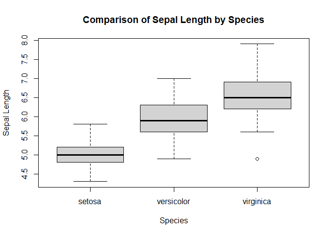<!-- -->

## 2.15 Relationship between two categorical variables

The `UCBAdmissions` dataset is built into R.

``` r
data("UCBAdmissions")
head(UCBAdmissions)
```

    ## , , Dept = A
    ## 
    ##           Gender
    ## Admit      Male Female
    ##   Admitted  512     89
    ##   Rejected  313     19
    ## 
    ## , , Dept = B
    ## 
    ##           Gender
    ## Admit      Male Female
    ##   Admitted  353     17
    ##   Rejected  207      8
    ## 
    ## , , Dept = C
    ## 
    ##           Gender
    ## Admit      Male Female
    ##   Admitted  120    202
    ##   Rejected  205    391
    ## 
    ## , , Dept = D
    ## 
    ##           Gender
    ## Admit      Male Female
    ##   Admitted  138    131
    ##   Rejected  279    244
    ## 
    ## , , Dept = E
    ## 
    ##           Gender
    ## Admit      Male Female
    ##   Admitted   53     94
    ##   Rejected  138    299
    ## 
    ## , , Dept = F
    ## 
    ##           Gender
    ## Admit      Male Female
    ##   Admitted   22     24
    ##   Rejected  351    317

Convert it into a data frame:

``` r
ucba <- data.frame(UCBAdmissions)
head(ucba)
```

    ##      Admit Gender Dept Freq
    ## 1 Admitted   Male    A  512
    ## 2 Rejected   Male    A  313
    ## 3 Admitted Female    A   89
    ## 4 Rejected Female    A   19
    ## 5 Admitted   Male    B  353
    ## 6 Rejected   Male    B  207

Create a table of gender and admission:

``` r
cross <- xtabs(Freq ~ Gender + Admit, data = ucba)
cross
```

    ##         Admit
    ## Gender   Admitted Rejected
    ##   Male       1198     1493
    ##   Female      557     1278

Calculate admission proportions by gender:

``` r
prop.table(cross, 1)
```

    ##         Admit
    ## Gender    Admitted  Rejected
    ##   Male   0.4451877 0.5548123
    ##   Female 0.3035422 0.6964578

### Exploring one department

``` r
cross2 <- xtabs(
  Freq ~ Gender + Admit,
  data = ucba[ucba$Dept == "F", ]
)

cross2
```

    ##         Admit
    ## Gender   Admitted Rejected
    ##   Male         22      351
    ##   Female       24      317

``` r
prop.table(cross2, 1)
```

    ##         Admit
    ## Gender     Admitted   Rejected
    ##   Male   0.05898123 0.94101877
    ##   Female 0.07038123 0.92961877

## 2.16 Creating bar plots

``` r
dat <- read.table(
  text = "ProdA ProdB ProdC ProdD
1 110 50 60 70
2 120 50 80 65",
  header = TRUE
)

dat
```

    ##   ProdA ProdB ProdC ProdD
    ## 1   110    50    60    70
    ## 2   120    50    80    65

``` r
barplot(
  as.matrix(dat),
  beside = TRUE,
  main = "Product Values",
  xlab = "Product",
  ylab = "Value",
  legend.text = TRUE
)
```

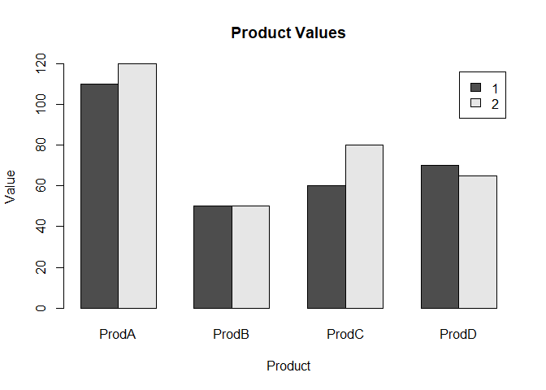<!-- -->

A second bar plot:

``` r
dat2 <- read.table(
  text = "A B C D E F G
1 10 80 30 90 70 60 90
2 20 50 70 50 40 10 40
3 60 80 80 60 60 30 160
4 20 40 70 80 20 10 70",
  header = TRUE
)

dat2
```

    ##    A  B  C  D  E  F   G
    ## 1 10 80 30 90 70 60  90
    ## 2 20 50 70 50 40 10  40
    ## 3 60 80 80 60 60 30 160
    ## 4 20 40 70 80 20 10  70

``` r
barplot(as.matrix(dat2), main = "Bar Plot of A to G")
```

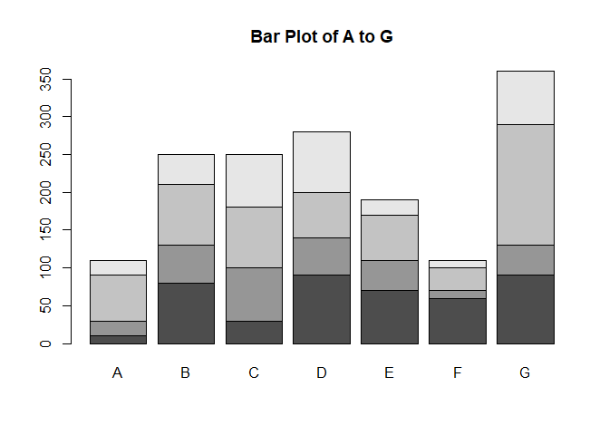<!-- -->

## 2.17 Scatter plots and correlation

``` r
plot(
  WEIGHT ~ HEIGHT,
  data = data_class,
  main = "Relationship Between Height and Weight",
  xlab = "Height (cm)",
  ylab = "Weight (kg)"
)
```

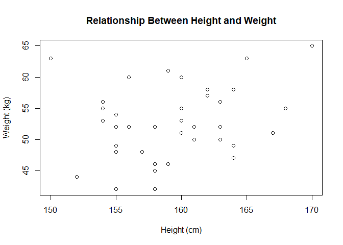<!-- -->

``` r
plot(
  data_class$HEIGHT,
  data_class$WEIGHT,
  main = "Height versus Weight",
  xlab = "Height",
  ylab = "Weight"
)
```

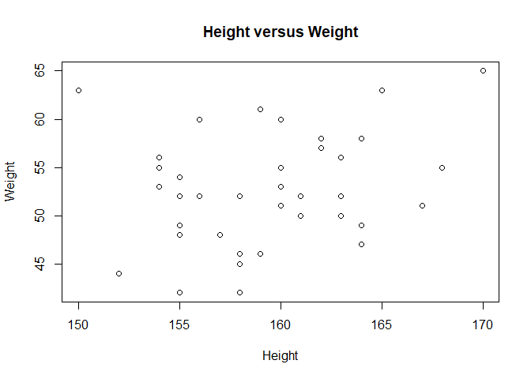<!-- -->

Calculate the correlation:

``` r
cor(data_class$HEIGHT, data_class$WEIGHT)
```

    ## [1] 0.2663495

## 2.18 Linear regression model

``` r
data_lm <- lm(HEIGHT ~ WEIGHT, data = data_class)
summary(data_lm)
```

    ## 
    ## Call:
    ## lm(formula = HEIGHT ~ WEIGHT, data = data_class)
    ## 
    ## Residuals:
    ##      Min       1Q   Median       3Q 
    ## -11.3563  -2.6662   0.2326   2.0378 
    ##      Max 
    ##   8.2449 
    ## 
    ## Coefficients:
    ##             Estimate Std. Error t value
    ## (Intercept) 148.7951     5.9466  25.022
    ## WEIGHT        0.1994     0.1127   1.769
    ##             Pr(>|t|)    
    ## (Intercept)   <2e-16 ***
    ## WEIGHT        0.0843 .  
    ## ---
    ## Signif. codes:  
    ##   0 '***' 0.001 '**' 0.01 '*' 0.05 '.'
    ##   0.1 ' ' 1
    ## 
    ## Residual standard error: 4.199 on 41 degrees of freedom
    ## Multiple R-squared:  0.07094,    Adjusted R-squared:  0.04828 
    ## F-statistic: 3.131 on 1 and 41 DF,  p-value: 0.08427

Plot the relationship and regression line:

``` r
plot(
  WEIGHT ~ HEIGHT,
  data = data_class,
  main = "Linear Relationship Between Height and Weight",
  xlab = "Height",
  ylab = "Weight"
)

abline(lm(WEIGHT ~ HEIGHT, data = data_class))
```

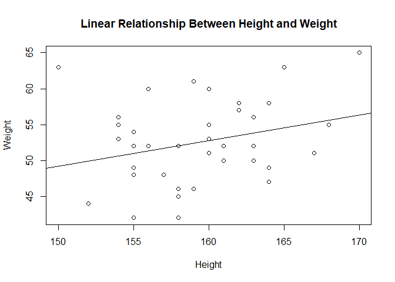<!-- -->

Diagnostic plots for the regression model:

``` r
plot(data_lm)
```

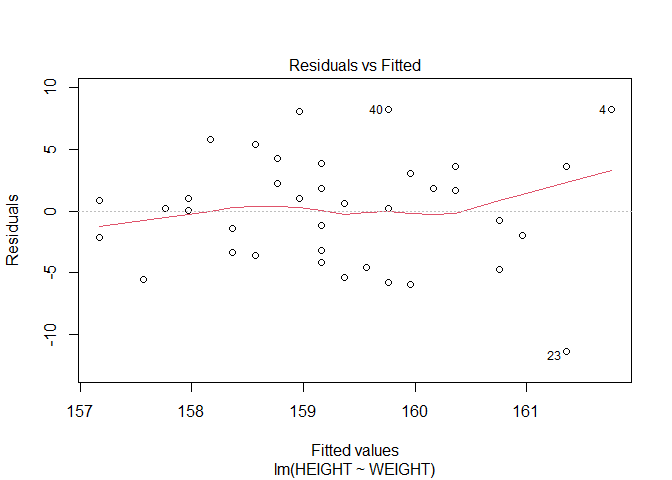<!-- -->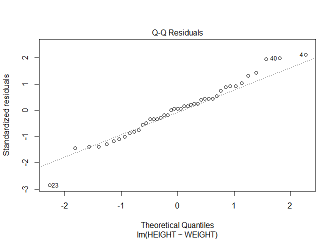<!-- -->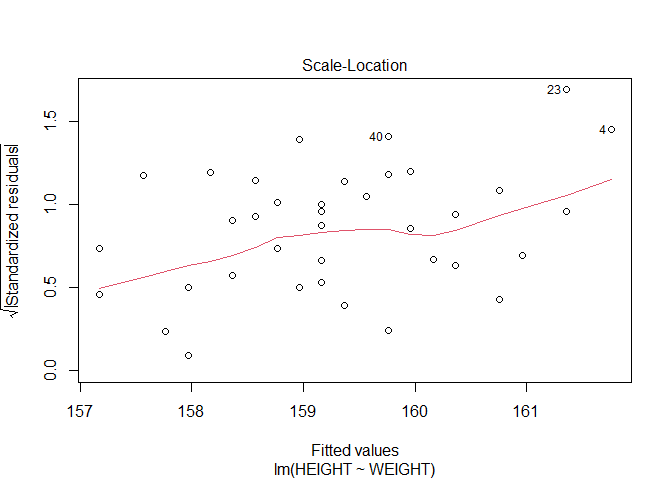<!-- -->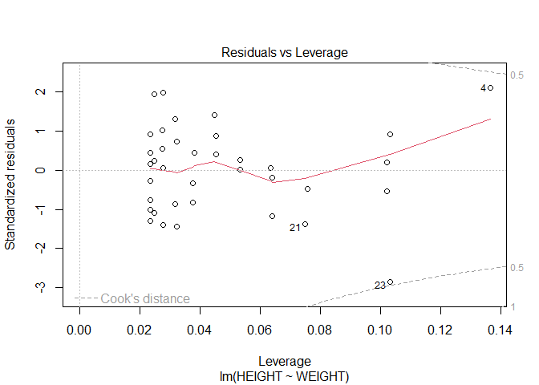<!-- -->

## 2.19 Histograms

``` r
hist(
  data_class$HEIGHT,
  main = "Distribution of Height",
  xlab = "Height"
)
```

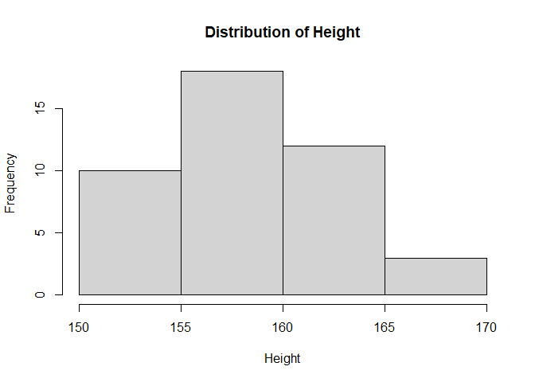<!-- -->

``` r
hist(
  data_class$WEIGHT,
  main = "Distribution of Weight",
  xlab = "Weight",
  col = "blue"
)
```

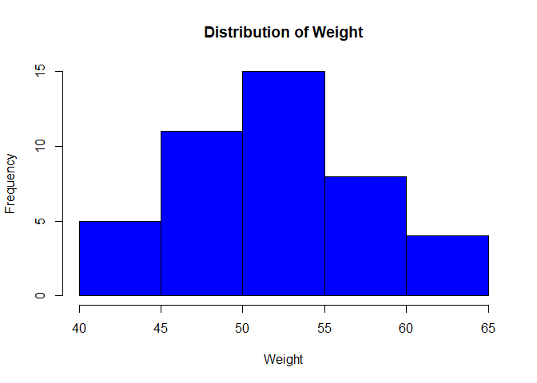<!-- -->

## 2.20 Adding a smooth line to a plot

``` r
plot(
  WEIGHT ~ HEIGHT,
  data = data_class,
  main = "Height and Weight with a Smooth Trend",
  xlab = "Height",
  ylab = "Weight"
)

abline(lm(WEIGHT ~ HEIGHT, data = data_class))
lines(
  lowess(data_class$HEIGHT, data_class$WEIGHT),
  col = "blue"
)
```

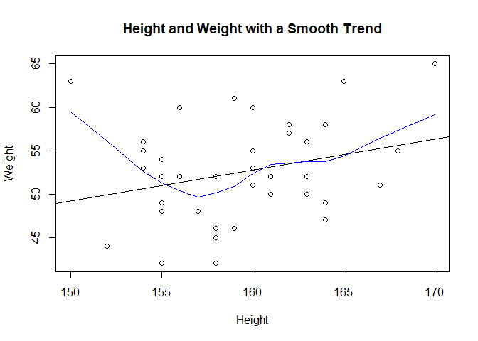<!-- -->

## 2.21 Creating a body mass index (BMI) variable

BMI is calculated as weight in kilograms divided by height in metres
squared.

``` r
BMI <- data_class$WEIGHT / (data_class$HEIGHT / 100)^2
BMI <- round(BMI, 2)

head(cbind(data_class, BMI), 5)
```

    ##   HEIGHT WEIGHT   BMI
    ## 1    161     50 19.29
    ## 2    155     49 20.40
    ## 3    158     42 16.82
    ## 4    170     65 22.49
    ## 5    160     60 23.44

Create a new data frame containing BMI:

``` r
new_data_class <- cbind(data_class, BMI)
tail(new_data_class, 10)
```

    ##    HEIGHT WEIGHT   BMI
    ## 34    165     63 23.14
    ## 35    156     60 24.65
    ## 36    163     56 21.08
    ## 37    155     52 21.64
    ## 38    164     47 17.47
    ## 39    163     52 19.57
    ## 40    168     55 19.49
    ## 41    157     48 19.47
    ## 42    164     58 21.56
    ## 43    154     55 23.19

Summary of BMI:

``` r
summary(BMI)
```

    ##    Min. 1st Qu.  Median    Mean 3rd Qu. 
    ##   16.82   19.16   20.40   20.70   22.23 
    ##    Max. 
    ##   28.00

Stem-and-leaf display:

``` r
stem(BMI, scale = 2)
```

    ## 
    ##   The decimal point is at the |
    ## 
    ##   16 | 8
    ##   17 | 55
    ##   18 | 0022348
    ##   19 | 03555569
    ##   20 | 0114778
    ##   21 | 145667
    ##   22 | 1455
    ##   23 | 12446
    ##   24 | 17
    ##   25 | 
    ##   26 | 
    ##   27 | 
    ##   28 | 0

## 2.22 Working with dates

Display the current date:

``` r
today <- Sys.Date()
today
```

    ## [1] "2026-11-02"

Format the date as month, day, and year:

``` r
format(today, format = "%B %d %Y")
```

    ## [1] "November 02 2026"

Display the day of the week:

``` r
format(today, format = "%A")
```

    ## [1] "Monday"

Calculate the number of days between two dates:

``` r
dob <- as.Date("2000-01-01")
reference_date <- as.Date("2026-10-31")

difftime(reference_date, dob, units = "days")
```

    ## Time difference of 9800 days

Another way to calculate the difference:

``` r
startdate <- as.Date("2000-01-01")
enddate <- as.Date("2026-10-31")

days <- enddate - startdate
days
```

    ## Time difference of 9800 days

## 2.23 Creating a leadership dataset

``` r
manager <- c(1, 2, 3, 4, 5)
country <- c("US", "US", "UK", "UK", "UK")
gender <- c("M", "F", "F", "M", "F")
age <- c(32, 45, 25, 39, 99)
q1 <- c(5, 3, 3, 3, 2)
q2 <- c(4, 5, 5, 3, 2)
q3 <- c(5, 2, 5, 4, 1)
q4 <- c(5, 5, 5, NA, 2)
q5 <- c(5, 5, 2, NA, 1)

leadership <- data.frame(
  manager, country, gender, age,
  q1, q2, q3, q4, q5
)

leadership
```

    ##   manager country gender age q1 q2 q3 q4
    ## 1       1      US      M  32  5  4  5  5
    ## 2       2      US      F  45  3  5  2  5
    ## 3       3      UK      F  25  3  5  5  5
    ## 4       4      UK      M  39  3  3  4 NA
    ## 5       5      UK      F  99  2  2  1  2
    ##   q5
    ## 1  5
    ## 2  5
    ## 3  2
    ## 4 NA
    ## 5  1

``` r
str(leadership)
```

    ## 'data.frame':    5 obs. of  9 variables:
    ##  $ manager: num  1 2 3 4 5
    ##  $ country: chr  "US" "US" "UK" "UK" ...
    ##  $ gender : chr  "M" "F" "F" "M" ...
    ##  $ age    : num  32 45 25 39 99
    ##  $ q1     : num  5 3 3 3 2
    ##  $ q2     : num  4 5 5 3 2
    ##  $ q3     : num  5 2 5 4 1
    ##  $ q4     : num  5 5 5 NA 2
    ##  $ q5     : num  5 5 2 NA 1

``` r
names(leadership)
```

    ## [1] "manager" "country" "gender"  "age"    
    ## [5] "q1"      "q2"      "q3"      "q4"     
    ## [9] "q5"

## 2.24 Handling missing values and creating age categories

Replace the age value 99 with a missing value:

``` r
leadership$age[leadership$age == 99] <- NA
leadership
```

    ##   manager country gender age q1 q2 q3 q4
    ## 1       1      US      M  32  5  4  5  5
    ## 2       2      US      F  45  3  5  2  5
    ## 3       3      UK      F  25  3  5  5  5
    ## 4       4      UK      M  39  3  3  4 NA
    ## 5       5      UK      F  NA  2  2  1  2
    ##   q5
    ## 1  5
    ## 2  5
    ## 3  2
    ## 4 NA
    ## 5  1

Create age categories:

``` r
leadership$agecat <- ifelse(
  is.na(leadership$age),
  NA,
  ifelse(
    leadership$age > 75,
    "Elder",
    ifelse(
      leadership$age >= 35,
      "Middle Aged",
      "Young"
    )
  )
)

leadership
```

    ##   manager country gender age q1 q2 q3 q4
    ## 1       1      US      M  32  5  4  5  5
    ## 2       2      US      F  45  3  5  2  5
    ## 3       3      UK      F  25  3  5  5  5
    ## 4       4      UK      M  39  3  3  4 NA
    ## 5       5      UK      F  NA  2  2  1  2
    ##   q5      agecat
    ## 1  5       Young
    ## 2  5 Middle Aged
    ## 3  2       Young
    ## 4 NA Middle Aged
    ## 5  1        <NA>

Check missing values in the questionnaire variables:

``` r
is.na(leadership[, 5:9])
```

    ##         q1    q2    q3    q4    q5
    ## [1,] FALSE FALSE FALSE FALSE FALSE
    ## [2,] FALSE FALSE FALSE FALSE FALSE
    ## [3,] FALSE FALSE FALSE FALSE FALSE
    ## [4,] FALSE FALSE FALSE  TRUE  TRUE
    ## [5,] FALSE FALSE FALSE FALSE FALSE

Remove rows containing missing values:

``` r
newdata <- na.omit(leadership)
newdata
```

    ##   manager country gender age q1 q2 q3 q4
    ## 1       1      US      M  32  5  4  5  5
    ## 2       2      US      F  45  3  5  2  5
    ## 3       3      UK      F  25  3  5  5  5
    ##   q5      agecat
    ## 1  5       Young
    ## 2  5 Middle Aged
    ## 3  2       Young

## 2.25 Sorting and subsetting data

Order the leadership records by age:

``` r
order(leadership$age)
```

    ## [1] 3 1 4 2 5

Select questionnaire variables:

``` r
myvars <- c("q1", "q2", "q3", "q4", "q5")
newdata3 <- leadership[myvars]
newdata3
```

    ##   q1 q2 q3 q4 q5
    ## 1  5  4  5  5  5
    ## 2  3  5  2  5  5
    ## 3  3  5  5  5  2
    ## 4  3  3  4 NA NA
    ## 5  2  2  1  2  1

Select columns by position:

``` r
newdata4 <- leadership[, c(-1, -2)]
head(newdata4)
```

    ##   gender age q1 q2 q3 q4 q5      agecat
    ## 1      M  32  5  4  5  5  5       Young
    ## 2      F  45  3  5  2  5  5 Middle Aged
    ## 3      F  25  3  5  5  5  2       Young
    ## 4      M  39  3  3  4 NA NA Middle Aged
    ## 5      F  NA  2  2  1  2  1        <NA>

Select individual columns:

``` r
leadership[[4]]
```

    ## [1] 32 45 25 39 NA

``` r
leadership$age
```

    ## [1] 32 45 25 39 NA

Select specific rows:

``` r
leadership[c(2, 4, 5), ]
```

    ##   manager country gender age q1 q2 q3 q4
    ## 2       2      US      F  45  3  5  2  5
    ## 4       4      UK      M  39  3  3  4 NA
    ## 5       5      UK      F  NA  2  2  1  2
    ##   q5      agecat
    ## 2  5 Middle Aged
    ## 4 NA Middle Aged
    ## 5  1        <NA>

Select records based on age:

``` r
newdata7 <- subset(
  leadership,
  age >= 35 | age < 24,
  select = c(q1, q2, q3, q4, q5)
)

newdata7
```

    ##   q1 q2 q3 q4 q5
    ## 2  3  5  2  5  5
    ## 4  3  3  4 NA NA

Select male managers older than 30:

``` r
male_managers <- leadership[
  leadership$gender == "M" & leadership$age > 30,
]

male_managers
```

    ##   manager country gender age q1 q2 q3 q4
    ## 1       1      US      M  32  5  4  5  5
    ## 4       4      UK      M  39  3  3  4 NA
    ##   q5      agecat
    ## 1  5       Young
    ## 4 NA Middle Aged

# Conclusion

This project demonstrated how to import data from CSV files, Excel
workbooks, a local database management system, and an online API. It
also covered R data structures, missing-value handling, descriptive
statistics, data management, visualization, correlation, linear
regression, BMI calculation, date operations, sorting, and subsetting.

The code and outputs in this report are generated when the R Markdown
document is knitted. Some sections require the relevant local files, a
running MySQL/MariaDB server, or an internet connection.
